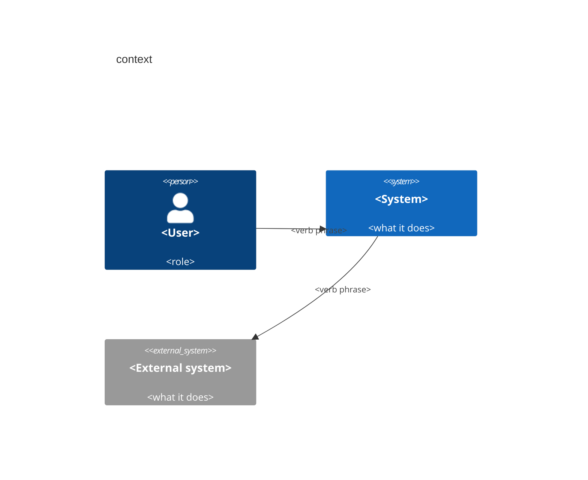

# Architecture

## C4 diagram

## Context map

| Context | Style | Publishes | Consumes | Storage |
| --- | --- | --- | --- | --- |
| <context> | <shared kernel, customer-supplier, conformist, anticorruption layer or open host> | <events or API it publishes> | <what it reads from other contexts> | <its store> |

## Component edges

| From (type) | Verb phrase | To (type) |
| --- | --- | --- |
| <component> (<service, library, store or queue>) | <calls, publishes to, reads> | <component> (<type>) |

## Dependency rules

| Rule | Paths | Enforced by |
| --- | --- | --- |
| <source> never imports <forbidden> | `src/<package>/<source>`, `src/<package>/<forbidden>` | `tests/test_architecture.py` |

## Domain rules

| Rule | Lives in |
| --- | --- |
| <rule> | `<module or function>` |

## Naming

| Kind | Form | Example |
| --- | --- | --- |
| Event | noun and past participle | `Order placed` |
| Failure event | `<noun> <action> failed` | `Payment capture failed` |
| Command | imperative | `Place order` |
| Policy | `<subject> <concern> policy`, each rule a predicate | `Order refund policy`: "an order is refundable when it shipped less than 30 days ago" |
